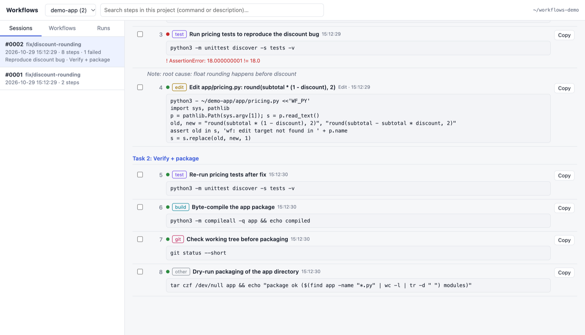
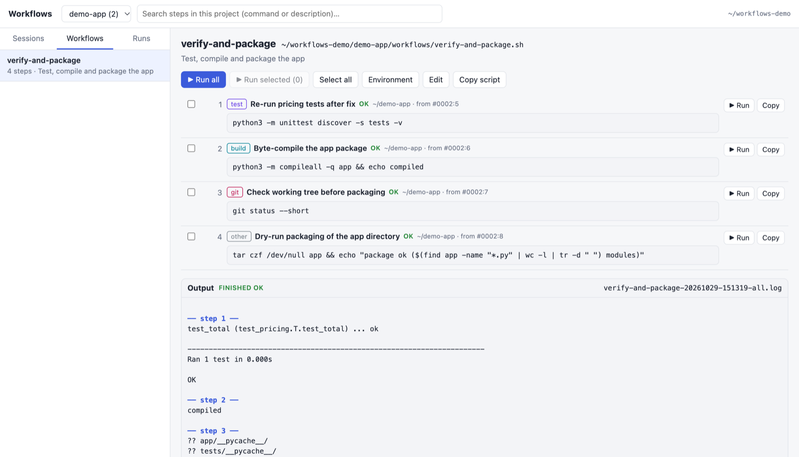

# claude-workflow-recorder

**Turn every Claude Code session into a replayable, commented shell workflow.**

Claude Code figures out *how* to build, test, debug and ship your project — then that knowledge
disappears into scrollback. This records every step, gives each session an incremental id, and lets
you regroup the steps into scripts you can rerun on your own, a single step at a time or all at once.



## What you get

| Piece | What it does |
|---|---|
| **Recorder** (Claude Code hooks) | Logs every tool call as a commented bash step: `#0001`, `#0002`, … per project. Bash commands verbatim; Claude's own `Read`/`Grep`/`Glob`/`Write`/`Edit`/`WebFetch` as their shell equivalents; agents / MCP calls as comments. Failures keep their last error line. |
| **`wf` CLI** | `list`, `show`, `search`, `mark` tasks, `note` findings, `extract` steps into a workflow, `run` it (all, one step, or a subset) in an isolated bash. |
| **Workflows app** (macOS) | Viewer + runner UI: browse sessions, filter by category, pick steps across sessions → create a workflow, then **Run all / Run selected / ▶ Run** one step with live output and per-step status. |
| **Workflows MCP server** | Lets any MCP client (Claude, Codex, Cursor…) search past steps and fetch only the relevant ones. |
| **MCP router** | One MCP server in front of many: clients see `search_tools` + `call_tool` instead of every server's full tool list; backends start lazily. |



## Install

Requires Python ≥ 3.9 (stdlib only), `jq`, and Claude Code. macOS or Linux (the app is macOS-only).

```bash
git clone https://github.com/ivikasavnish/claude-workflow-recorder.git
cd claude-workflow-recorder
./install.sh            # or: --no-router  --no-app  --no-hooks
```

The installer is idempotent. It backs up `~/.claude/settings.json` before **appending** its hooks
(your existing hooks are kept), links `wf` into `~/.local/bin`, registers the router with Claude Code,
and builds `~/Applications/Workflows.app`. Start a new Claude Code session — it announces `Session #0001`.

Uninstall: `./uninstall.sh` (removes hooks, router registration and the `wf` link; keeps your data).

## How it works

```
Claude Code ──hooks──▶ wf.py hook ──▶ ~/workflows/<project>/
  SessionStart                         index.json            session uuid → #0001, #0002…
  PostToolUse(*)                       sessions/0002.sh      commented, human-readable log
  PostToolUseFailure(*)                sessions/0002.jsonl   machine-readable (source of truth)
                                       sessions/0002.files/  exact snapshots of large writes
                                       workflows/<name>.sh   extracted runnable workflows
                                       runs/<name>-….log     run output with step/exit markers
```

A session log looks like this:

```bash
# ── step 3 · 15:12:29 · [test] · FAILED · task 1
# Run pricing tests to reproduce the discount bug
# ! AssertionError: 18.000000001 != 18.0
python3 -m unittest discover -s tests -v

# ── step 4 · 15:12:29 · [edit] · ok · task 1
# Edit app/pricing.py: round(subtotal * (1 - discount), 2)
python3 - ~/demo-app/app/pricing.py <<'WF_PY'
...exact-string replacement, fails like Edit if the text is missing...
WF_PY
```

| Claude tool | Recorded as |
|---|---|
| Bash | the command, with its description as the comment |
| Read | `cat` / `sed -n 'a,bp'` / `head -n` |
| Grep / Glob | `grep -rE …` / `find … -name` (portable, no ripgrep needed) |
| Write | heredoc, or an exact snapshot + `cp` for large / no-trailing-newline files |
| Edit / MultiEdit | a `python3` exact-string replacement |
| WebFetch | `curl -sL <url>` |
| Agent, WebSearch, Skill, MCP tools | `# [Tool] …` comment lines |

Steps are auto-categorised (`find`, `debug`, `test`, `build`, `run`, `git`, `edit`, `note`, `other`).

## Using it

```bash
wf list                                   # sessions with per-category counts and task titles
wf show 7 --cat test,build                # one session, filtered
wf search 'gradlew|adb'                   # regex across all sessions
wf mark -s 7 "Reproduce crash"            # start a task section (Claude does this via the skill)
wf extract release --from 7@2 8:3-9 --exclude-cat find,note -d "Build, test, package"
wf run release                            # all steps
wf run release --steps 3                  # one step, in its recorded directory
wf run release --steps 2-4 -e API_TOKEN="$TOKEN"
wf ui                                     # open the app
```

Selectors: `7` (whole session), `7:3-9,12` (steps), `7@2` (task 2), `last`, `all`.

`wf run` and the app use a fresh `bash --noprofile --norc` with `set -euo pipefail` and a minimal
environment (`HOME PATH USER TERM LANG JAVA_HOME ANDROID_HOME ANDROID_SDK_ROOT`); add variables with
`-e`/the Environment panel or pass `--inherit-env`. Every step runs in the directory it was recorded
in, so any subset of steps works on its own.

### MCP

The router exposes four tools: `search_tools(query)`, `call_tool(server__tool, arguments)`,
`list_servers`, `refresh_index`. Put stdio servers behind it in `~/mcp-router/servers.json`.
The workflows server can also be registered directly with any client:

```bash
python3 ~/.claude/skills/workflow-recorder/wf_mcp.py     # stdio
```

## Security & privacy

- Logs live in `~/workflows`, **outside your repos**, so they're never committed by accident.
- Common secrets in commands are redacted (`Authorization:` headers, `*_KEY=`/`*_TOKEN=`/`*_SECRET=` values,
  `--password`-style flags, `sk-…`, `ghp_…`, `AIza…`). Runs refuse steps that still contain `<REDACTED>`.
- Writes/edits to `.env*`, `*secret*`, `*credential*`, `*.pem`, `*.key` are logged as comments only.
  Other `Write`/`Edit` content is stored verbatim so replays are byte-exact — treat `~/workflows` as sensitive.
- The app binds `127.0.0.1` only, rejects foreign `Host` headers (DNS rebinding) and requires a
  per-launch token on every state-changing request.
- Running a workflow executes shell commands. Review a workflow before you run it.

## Development

```bash
python3 -m unittest discover -s tests -v
```

No dependencies. CI runs on Linux and macOS with Python 3.9 and 3.12, plus an installer smoke test.

## License

MIT
